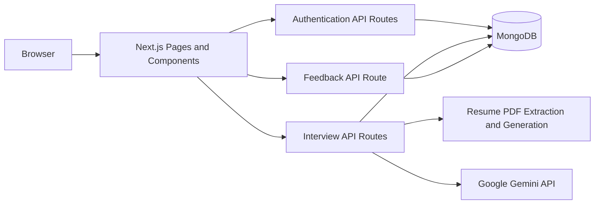
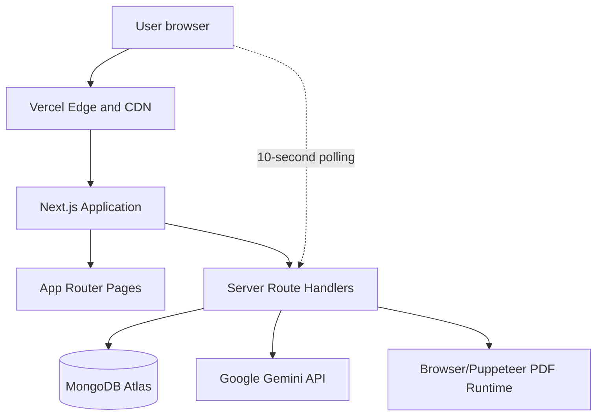
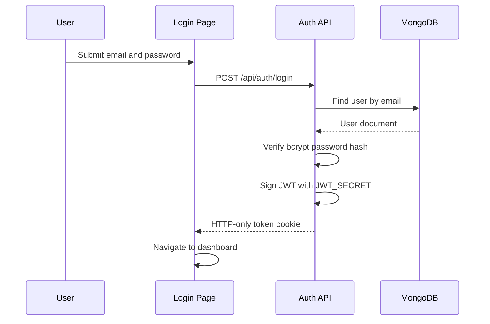
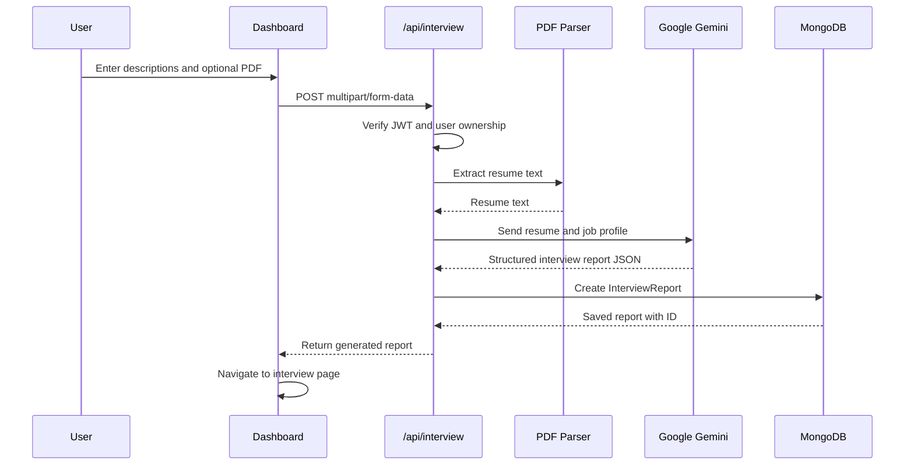
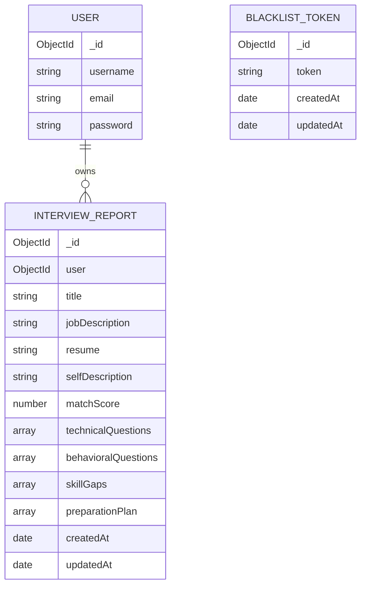
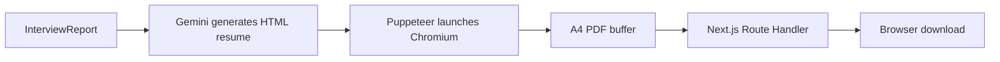

# CarrierGuider AI Architecture

This document describes how the complete Next.js application is structured, how data moves between components, and where each technology belongs.

## High-Level Architecture



There are no separate Express frontend or backend servers. Both are delivered by one Next.js application:

- React and Next.js pages provide the UI.
- Route Handlers under `app/api` provide backend endpoints.
- MongoDB stores users, reports, and invalidated tokens.
- Gemini performs analysis and resume content generation.

## Deployment Architecture



Vercel serves static assets and page routes while Next.js executes API Route Handlers as serverless functions.

## Directory Responsibility

### `app/`

`app/` contains the UI and backend routes according to Next.js App Router conventions.

- `page.jsx` is the dashboard.
- `login/page.jsx` contains login UI.
- `register/page.jsx` contains registration UI.
- `interview/[interviewId]/page.jsx` displays one report.
- `layout.jsx` defines the root HTML layout and React providers.
- `globals.scss` contains global and shared styles.
- `api/` contains server-only Route Handlers.

### `components/`

Reusable React state providers live here:

- `auth-provider.jsx` tracks authentication UI state.
- `interview-provider.jsx` tracks report and interview loading state.
- `feedback-board.jsx` submits reviews and refreshes the shared feedback board while visible.

These providers are imported by `app/layout.jsx` and run in the browser where marked with `'use client'`.

### `lib/`

`lib/` contains reusable server-side functionality:

- `db.js`: MongoDB connection and server connection caching.
- `models.js`: Mongoose schemas.
- `auth.js`: JWT cookie verification and blacklist lookup.
- `ai.js`: Gemini report generation and Puppeteer PDF generation.

## Authentication Flow



Registration follows the same pattern but first checks for an existing username or email, then hashes the password and creates the user.

Logout adds the JWT to the blacklist collection and clears the cookie.

## Interview Report Flow



The report contains:

```text
InterviewReport
├── user
├── jobDescription
├── resume
├── selfDescription
├── title
├── matchScore
├── technicalQuestions
├── behavioralQuestions
├── skillGaps
└── preparationPlan
```

## Feedback Flow

Authenticated users can create or update one app-wide review with a 1–5 star rating and a comment of up to 1000 characters. MongoDB stores the review against its user account. The API returns usernames (not email addresses), review timestamps, the latest 100 comments, and the average rating/count. The dashboard polls the API every 10 seconds while visible, which is compatible with Vercel's serverless execution model and does not require persistent WebSocket infrastructure.

## Report Ownership Model

Every report has a `user` ObjectId reference. Protected report routes query with both values:

```text
{ _id: interviewId, user: authenticatedUserId }
```

This prevents users from requesting reports that belong to another account.

## Database Architecture



## MongoDB Connection Strategy

`lib/db.js` creates and caches a Mongoose connection in the Node.js process. Reusing a connection is important because serverless functions may execute multiple requests in a warm environment.

```text
Request
  → connectDB()
  → Existing connection available? Return it
  → No connection? Create mongoose.connect(MONGO_URI)
  → Cache and reuse the connection
```

## API and UI Boundary

The browser does not directly access MongoDB, JWT verification logic, the Gemini key, or PDF generation code. It communicates only through `/api` routes.

```text
Browser
  ↓ fetch/FormData
Next.js Route Handlers
  ↓ server-only imports
MongoDB / Gemini / PDF libraries
```

This separation keeps secrets on the server and provides a simple deployment model.

## PDF Generation Architecture



Puppeteer and Chromium are hosted server-side. This operation can exceed serverless limits for package size, memory, CPU duration, or Chromium startup, so it may need a dedicated PDF service or longer-running runtime for reliable production use.

## Request Lifecycle

### Page request

```text
Browser request
→ Vercel
→ Next.js App Router
→ React page component
→ Browser-side state or providers
→ API request when data is required
```

### API request

```text
Browser fetch
→ Next.js Route Handler
→ JWT/cookie authentication helper
→ MongoDB and/or Gemini
→ JSON response or file response
→ Browser updates UI or downloads PDF
```

## Environment and Secrets

```text
.env.local / Vercel environment
├── MONGO_URI
├── JWT_SECRET
└── GOOGLE_GENAI_API_KEY
```

`MONGO_URI` and `GOOGLE_GENAI_API_KEY` must only be used by server code. `JWT_SECRET` must remain private and should be stable across all deployments of the same application.

## Scaling Considerations

- MongoDB Atlas connection pooling reduces repeated connection cost.
- Gemini and PDF operations can be slow; expose loading states and consider request limits.
- Logout blacklist entries should have an expiration or cleanup process in high-volume deployments.
- Gemini API keys should use usage limits and spend alerts.
- PDF generation should ideally move to a queue or dedicated worker if the endpoint becomes unreliable.

## Local versus Vercel Behavior

| Concern | Local | Vercel |
|---|---|---|
| UI | Next.js development server | Vercel CDN and Next.js runtime |
| API | Next.js Route Handler server | Serverless function |
| Database | MongoDB network connection | MongoDB network connection |
| Cookies | Local HTTP cookie | Secure production HTTP-only cookie |
| Gemini | Server-side call | Server-side call |
| Puppeteer | Local Chromium process | Serverless Chromium process with deployment constraints |

## Security Boundaries

```text
Public
├── /login
├── /register
└── POST /api/auth/login and /api/auth/register

Authenticated
├── /
├── /interview/[interviewId]
├── /api/auth/get-me
├── /api/auth/logout
├── /api/interview
├── /api/interview/report/[interviewId]
└── /api/interview/resume/pdf/[interviewReportId]
```

Authentication is performed by reading and verifying the HTTP-only JWT cookie before protected Route Handlers access data.
